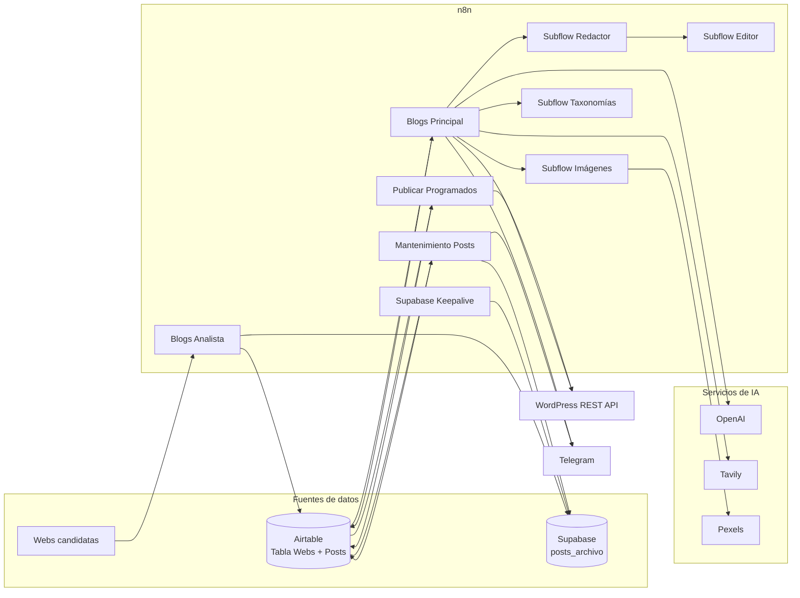

# N8N Blog — Automatización editorial con IA

Sistema de automatización para descubrir webs, generar temas, redactar artículos, crear imágenes y taxonomías, publicar en WordPress y archivar el histórico en Supabase. Está construido sobre **n8n**, **Airtable**, **Supabase (Postgres)**, **WordPress REST API**, **OpenAI**, **Tavily** y **Pexels**.

---

## Contenido

- [1. Visión general](#1-visión-general)
- [2. Arquitectura](#2-arquitectura)
- [3. Inventario de workflows](#3-inventario-de-workflows)
  - [3.1 Blogs Analista con Supabase (v2)](#31-blogs-analista-con-supabase-v2)
  - [3.2 Blogs Principal](#32-blogs-principal)
  - [3.3 Mantenimiento Posts (auto-borrado)](#33-mantenimiento-posts-auto-borrado)
  - [3.4 Supabase Keepalive](#34-supabase-keepalive)
  - [3.5 Publicar Programados](#35-publicar-programados)
  - [3.6 Subflows](#36-subflows)
- [4. Modelo de datos](#4-modelo-de-datos)
  - [4.1 Airtable](#41-airtable)
  - [4.2 Supabase](#42-supabase)
  - [4.3 Estados y ciclo de vida](#43-estados-y-ciclo-de-vida)
- [5. Archivado y deduplicación](#5-archivado-y-deduplicación)
  - [5.1 Regla de capacidad](#51-regla-de-capacidad)
  - [5.2 Selección del lote](#52-selección-del-lote)
  - [5.3 Verificación y borrado](#53-verificación-y-borrado)
  - [5.4 Deduplicación](#54-deduplicación)

---

## 1. Visión general

El sistema cubre el ciclo completo de un blog corporativo:

1. **Descubrimiento.** `Blogs Analista` recibe URLs de webs candidatas, las scrapea, las resume con un LLM y crea hasta **8 temas** por web en Airtable. Antes de proponerlos comprueba que no existan ya, ni en `Posts` ni en el archivo de Supabase.
2. **Redacción.** `Blogs Principal` toma un tema pendiente, investiga con búsqueda externa en Tavily, redacta con una plantilla editorial, corrige el texto, genera imágenes (Pexels), crea categorías y etiquetas en WordPress y sube el artículo.
3. **Publicación.** El artículo se sube como `publish` o `draft` según el campo `Modo publicación` de la web. `Publicar Programados` puede pasar a publicado los borradores cuya fecha ya venció.
4. **Archivo.** `Mantenimiento Posts` corre una vez al mes. Si `Posts` supera **900** registros, copia los más antiguos a Supabase, verifica que la copia existe y **solo entonces** los borra de Airtable, dejando ~**750**.
5. **Supervivencia del plan Free.** `Supabase Keepalive` hace un `SELECT 1` semanal para que el proyecto de Supabase no se pause por inactividad.

### Restricciones que condicionan el diseño

| Restricción                                              | Consecuencia en el diseño                                                              |
| -------------------------------------------------------- | -------------------------------------------------------------------------------------- |
| Airtable Free: **1.000 registros por base**              | Archivado mensual con umbral 900 y objetivo 750.                                       |
| API de Airtable justa                                    | El mantenimiento lee una vez, escribe en lotes de 10 y solo actúa si supera el umbral. |
| Supabase Free se pausa a los 7 días sin actividad        | Keepalive semanal con `SELECT 1` (0 llamadas a Airtable).                              |
| Los temas pendientes no deben perderse                   | `No creado` y `Estado` vacío **nunca** se archivan ni se borran.                       |
| El borrado es irreversible en Airtable                   | Se verifica cada `airtable_id` en `posts_archivo` antes de borrar.                     |
| Los títulos borrados deben seguir contando para el dedup | El Analista consulta también `posts_archivo`.                                          |

---

## 2. Arquitectura



### Flujo editorial resumido

```text
Web candidata
  └─ Blogs Analista (cada 3 días)
       ├─ scrapea la web y la resume con IA
       ├─ lee títulos vivos (Posts) + archivados (Supabase)
       ├─ crea hasta 8 temas en Posts (Estado = No creado)
       └─ marca la web como Añadido

Posts pendiente
  └─ Blogs Principal (schedule + auto-invocación)
       ├─ elige web con Próxima fecha vencida y post pendiente
       ├─ investiga: Tavily + índice de posts de WordPress
       ├─ redacta y corrige (subflows Redactor + Editor)
       ├─ genera imágenes y taxonomías (subflows Imágenes + Taxonomías)
       ├─ sube a WordPress (publish o draft)
       └─ marca Estado = Creado, guarda WP Post ID y actualiza Última publicación

Posts Creado con fecha vencida
  └─ Publicar Programados (cada 12 h)
       └─ PATCH status = publish y Estado = Publicado

Posts antiguos
  └─ Mantenimiento Posts (mensual)
       ├─ si total > 900: copia a Supabase, verifica y borra de Airtable
       └─ si total ≤ 900: no hace nada
```

---

## 3. Inventario de workflows

| Workflow                           | Archivo fuente                                                                                                                                                                                                                                         | Disparador                                                | Estado esperado                         |
| ---------------------------------- | ------------------------------------------------------------------------------------------------------------------------------------------------------------------------------------------------------------------------------------------------------ | --------------------------------------------------------- | --------------------------------------- |
| Blogs Analista con Supabase (v2)   | [`Blogs Analista.json`](./Blogs%20Analista.json)                                                                                                                                                                                                       | Cada 3 días                                               | Activo                                  |
| Blogs Principal                    | [`Blogs Principal.json`](./Blogs%20Principal.json)                                                                                                                                                                                                     | Schedule Trigger + invocación manual/encadenada           | Activo                                  |
| Mantenimiento Posts (auto-borrado) | [`Mantenimiento Posts.json`](./Mantenimiento%20Posts.json)                                                                                                                                                                                             | Mensual, día 1 a las 03:00 (`0 3 1 * *`, America/Caracas) | Activo                                  |
| Supabase Keepalive                 | [`Supabase Keepalive.json`](./Supabase%20Keepalive.json)                                                                                                                                                                                               | Semanal, lunes 08:00 (`0 8 * * 1`, America/Caracas)       | Activo                                  |
| Publicar Programados               | [`Publicar Programados.json`](./Publicar%20Programados.json)                                                                                                                                                                                           | Cada 12 horas                                             | Inactivo en el export; confirmar en n8n |
| Subflows (4)                       | [`Subflow_redactor_blog.json`](./Subflow_redactor_blog.json), [`Subflow_editor_blog.json`](./Subflow_editor_blog.json), [`Subflow_imagenes_blog.json`](./Subflow_imagenes_blog.json), [`Subflow_taxonomias_blog.json`](./Subflow_taxonomias_blog.json) | Invocados por Blogs Principal                             | Inactivos (correcto: son subflujos)     |

### 3.1 Blogs Analista con Supabase (v2)

- **Archivo:** [`Blogs Analista.json`](./Blogs%20Analista.json)
- **Trigger:** `Schedule Trigger`, cada 3 días.
- **Credenciales:** `Airtable Synergiart`, `OpenAI Synergiart`, `Supabase Archive`.
- **Función:** analizar webs, generar temas y evitar duplicados.

**Qué hace, paso a paso:**

1. `Search posts pendientes` lee los Posts con `Estado != Creado` y `Estado != Publicado`.
2. `Search webs añadidas` lee las Webs con `Estado = Añadido`.
3. `Filtrar webs (b)` descarta las webs añadidas que ya tienen posts pendientes. Así una web activa no se re-analiza hasta drenar su cola (máximo efectivo: 8 pendientes por web).
4. `Search records` lee las Webs con `Estado != Añadido` (candidatas nuevas).
5. `Webs a procesar` une ambas ramas.
6. `Títulos archivados` consulta Supabase (`posts_archivo`) por la URL de la web; `Buscar títulos existentes` consulta Airtable (`Posts`) por la misma URL.
7. `Adjuntar títulos` normaliza y fusiona ambos conjuntos, y añade a cada web `existingTitles` y `existingTitlesText`.
8. `HTTP Request` descarga la web; `Markdown` la convierte; el `AI Agent` la resume y propone hasta 8 temas, con la lista de títulos existentes en el prompt como prohibición explícita.
9. `Crear temas` inserta una fila por tema con `Estado = No creado`; `Añadir web` actualiza la web con nombre, contexto, categorías e idioma.
10. `Split Out` separa los temas y `Crear temas` los escribe en Airtable.

**Deduplicación:** el prompt recibe los títulos existentes y el nodo `Adjuntar títulos` los normaliza (minúsculas, sin barras finales en la URL). El filtro es de **coincidencia exacta normalizada**; no hay fuzzy (el diagnóstico de la Fase 0 no encontró duplicados). Ver [5.4 Deduplicación](#54-deduplicación).

### 3.2 Blogs Principal

- **Archivo:** [`Blogs Principal.json`](./Blogs%20Principal.json)
- **Trigger:** `Schedule Trigger1` (el export trae el intervalo vacío: **confirmar en n8n**), `Execute Workflow Trigger` para invocación manual/encadenada y `Re-ejecutar flujo` para procesar la siguiente web.
- **Función:** redactar y subir un artículo por ejecución y por web.

**Qué hace:**

1. `Webs candidatas` lee las Webs con `activo = Si`.
2. `Buscar posts pendientes` obtiene los Posts con `Estado != Creado` y `Temas != ''`.
3. `Resumir URLs pendientes` calcula qué webs tienen trabajo y cuáles son urgentes (posts con `Fecha creación` de hoy).
4. `Seleccionar web objetivo` elige **una** web: primero las urgentes; luego las que tienen `Próxima fecha <= hoy`; desempata por `Última publicación` más antigua.
5. `Search records` selecciona **un** post de esa web: si es urgente, uno creado hoy; si no, uno sin `Fecha creación`.
6. `Buscar posts WP` trae los últimos 20 posts publicados del sitio para evitar canibalización; `Buscar fuentes Tavily` trae hasta 3 fuentes externas. El RAG de Pinecone fue retirado: el briefing se genera solo con el tema, el contexto de la marca y esas fuentes.
7. `Preparar datos redactor1` pasa al subflow Redactor el tema, contexto de marca, categorías, idioma, posts, fuentes y los campos editoriales (`templateForzado`, `modoCustom`, `tematicaEspecifica`, `tipoEscritura`, `estiloRedaccion`, `intencionArticulo`).
8. Subflows: Redactor → Editor → Artículo final → Imágenes + Taxonomías.
9. `Subir post` hace `POST /wp-json/wp/v2/posts` con `status: publish` salvo que `Modo publicación = Borrador`.
10. `Update record` marca `Estado = Creado`; `Update record1` actualiza `Última publicación` de la web; `Subir post` sube el artículo; `Patch Yoast focuskw` actualiza la frase clave; `Set WP Post ID` / `Update WP Post ID` guardan el id de WordPress en Airtable.
11. `Verificar más pendientes` mira si queda otra web con `Próxima fecha <= hoy` y `activo = Si`; si hay, `Re-ejecutar flujo` vuelve a invocar el workflow.

### 3.3 Mantenimiento Posts (auto-borrado)

- **Archivo:** [`Mantenimiento Posts.json`](./Mantenimiento%20Posts.json)
- **Trigger:** `Schedule Trigger (mensual)` → `0 3 1 * *`, zona `America/Caracas`.
- **Función:** archivar en Supabase y borrar de Airtable cuando se supera el umbral.

**Parámetros (nodo `Configuración`):**

| Parámetro          | Valor | Significado                                                              |
| ------------------ | ----: | ------------------------------------------------------------------------ |
| `umbral`           |   900 | Se archiva si `Posts` tiene más de 900 registros.                        |
| `objetivo`         |   750 | Se dejan ~750 registros en Airtable.                                     |
| `diasError`        |    90 | Los `Error` solo se archivan si tienen más de 90 días.                   |
| `avisoPorEncimaDe` |   950 | Aviso si, tras borrar, quedarían más de 950 (el volumen son pendientes). |

**Flujo:**

```text
Schedule Trigger (mensual)
  → Configuración
  → Posts - todos (solo lectura)
  → Seleccionar lote (Code)
  → ¿Hay algo que hacer?
      ├─ No → Nada que hacer
      └─ Sí → Insertar en Supabase
                → Verificar en Supabase
                → Preparar borrado (lotes de 10)
                → ¿Borrar algo?
                    ├─ No → Aviso
                    └─ Sí → Borrar en Airtable
                              → Contar borrado
                              → Aviso
```

**Garantías del diseño:**

- Solo lectura de `Posts` hasta el paso de borrado.
- `ON CONFLICT (airtable_id) DO NOTHING`: reintentar el job no duplica filas.
- `Verificar en Supabase` consulta los ids insertados; `Preparar borrado` **solo** incluye los ids confirmados. Si falta uno, se omite y se reporta en `skipped`.
- El `DELETE` se hace con la API REST de Airtable en lotes de 10 (`records[]`), no con el nodo Airtable.
- Los pendientes (`No creado` o vacío) nunca entran en el lote.
- El aviso de Telegram incluye registros antes/después, desglose por estado, copiados, borrados y fecha de corte.

### 3.4 Supabase Keepalive

- **Archivo:** [`Supabase Keepalive.json`](./Supabase%20Keepalive.json)
- **Trigger:** semanal, lunes 08:00 (`0 8 * * 1`, America/Caracas).
- **Credencial:** `Supabase Archive`.
- **Función:** `SELECT 1 AS ok;` para que el proyecto Free no se pause por 7 días de inactividad. No toca Airtable.

### 3.5 Publicar Programados

- **Archivo:** [`Publicar Programados.json`](./Publicar%20Programados.json)
- **Trigger:** cada 12 horas.
- **Credencial:** `Airtable Synergiart` (las credenciales de WordPress salen de la tabla `Webs`).
- **Función:** publicar borradores programados.

**Lógica:**

1. `Buscar Webs` lee todas las webs y sus credenciales de WordPress.
2. `Buscar Posts a Publicar` filtra `Estado = Creado`, `WP Post ID > 0` y `Fecha publicación <= TODAY()`.
3. `Merge Sites with Posts` resuelve la web de cada post y construye el `Basic Auth`.
4. `Publicar en WordPress` hace `PATCH /wp-json/wp/v2/posts/{id}` con `{"status":"publish"}`.
5. `Update Estado Publicado` marca `Estado = Publicado` por `WP Post ID`.

### 3.6 Subflows

Los cuatro subflows se invocan desde `Blogs Principal` con `Execute Workflow` y `inputSource: passthrough`. No tienen trigger propio.

| Subflow    | Archivo                                                          | Entrada principal                                                                                                                                                                                                           | Salida principal                                                                                                                |
| ---------- | ---------------------------------------------------------------- | --------------------------------------------------------------------------------------------------------------------------------------------------------------------------------------------------------------------------- | ------------------------------------------------------------------------------------------------------------------------------- |
| Redactor   | [`Subflow_redactor_blog.json`](./Subflow_redactor_blog.json)     | `topic`, `briefing`, `brandContext`, `categoriesInput`, `language`, `siteUrl`, `postsIndex`, `sourcesIndex`, `templateForzado`, `modoCustom`, `tematicaEspecifica`, `tipoEscritura`, `estiloRedaccion`, `intencionArticulo` | JSON con `title`, `content`, `slug`, `excerpt`, `focusKeyphrase`, `categoryNames`, `tags`, `seoMetaTitle`, `seoMetaDescription` |
| Editor     | [`Subflow_editor_blog.json`](./Subflow_editor_blog.json)         | Texto/JSON del artículo redactado                                                                                                                                                                                           | Artículo corregido con el mismo contrato                                                                                        |
| Imágenes   | [`Subflow_imagenes_blog.json`](./Subflow_imagenes_blog.json)     | `siteUrl`, `wpUser`, `wpPassword`, `topic`, `title`, `content`                                                                                                                                                              | `content` con imagen inline insertada, `featuredMediaId`, `headerAuthRaw`, `excerpt`                                            |
| Taxonomías | [`Subflow_taxonomias_blog.json`](./Subflow_taxonomias_blog.json) | `siteUrl`, `wpUser`, `wpPassword`, `categoryNames`, `tags`                                                                                                                                                                  | `final_ids` (categorías), `final_tag_ids` (etiquetas), `headerAuthRaw`                                                          |

#### Redactor

- **Selector de Plantilla:** si `templateForzado` tiene valor distinto de `Auto`, usa esa plantilla y se salta el scoring. Si no, infiere la plantilla a partir del tema y el briefing.
- **Plantillas disponibles:** `HowTo`, `FAQ`, `Review`, `Listicle`, `CaseStudy`, `DevBlog`, `Editorial`, `ShortArticle`. Cada una define longitud objetivo, guía de estructura HTML y schema JSON-LD.
- **`Estructura Custom`:** si tiene contenido, se usa como referencia de formato y se infieren estructura, longitud, tipo y estilo. Los campos `Temática específica`, `Intención del artículo`, `Tipo de escritura` y `Estilo de redacción` tienen precedencia sobre lo inferido.
- **Idioma:** el prompt trabaja con el idioma objetivo de la web (Español/Inglés) y valida que el resultado esté en ese idioma.
- **Salida:** el nodo `Parser redacción1` tolera JSON malformado y extrae los campos con expresiones regulares.

#### Editor

- **Función:** corrección editorial (estilo, coherencia, enlaces, estructura) sin cambiar el enfoque.
- **Salida:** el `Parser Editor` normaliza el JSON y devuelve el mismo contrato del Redactor.

#### Imágenes

1. `Keyword imagen` genera una keyword visual a partir del tema.
2. `Buscar en pexels` busca 40 fotos horizontales; `Seleccionar foto aleatoria` elige una principal y una inline.
3. Descarga, calcula el `Basic Auth` de WordPress y sube ambas a `/wp-json/wp/v2/media`.
4. `Patch imagen SEO` actualiza alt/title de la imagen principal; el mismo proceso se repite para la inline.
5. `Salida imagenes` inserta la imagen inline en el punto medio del contenido (en un límite de bloque HTML), sanea enlaces malformados y devuelve el HTML final.

#### Taxonomías

1. `Auth taxonomias` construye el `Basic Auth` desde `wpUser`/`wpPassword`.
2. `Preparar taxonomias` normaliza categorías y etiquetas (máx. 32 caracteres por categoría, sin truncar palabras).
3. Para cada categoría: busca en `/wp-json/wp/v2/categories`; si existe, recupera su id; si no, la crea. Lo mismo con `/wp-json/wp/v2/tags`.
4. `Recuperar Id categoria1` y `Recuperar Tag Id1` puntúan candidatos por nombre, slug y tokens para evitar duplicados semánticos.
5. `Salida taxonomias` devuelve `final_ids` y `final_tag_ids`.

---

## 4. Modelo de datos

### 4.1 Airtable

- **Base:** `appOaontVX9RVfWzd`.
- **Tabla `Webs`**.
- **Tabla `Posts`**.

#### Tabla `Webs`

| Campo                       | Tipo                   | Uso                                                                               |
| --------------------------- | ---------------------- | --------------------------------------------------------------------------------- |
| `Nombre de las webs`        | Texto                  | Nombre comercial del sitio.                                                       |
| `URL`                       | Texto/URL              | Clave de unión con Posts y WordPress. Se normaliza sin `/` final y en minúsculas. |
| `Estado`                    | Selector               | `Añadido` / `No añadido`. Las `No añadido` son candidatas a análisis.             |
| `activo`                    | Selector               | `Si` / `No`. Solo las activas entran en `Blogs Principal`.                        |
| `Contexto de la web`        | Texto largo            | Contexto de marca que recibe el Redactor.                                         |
| `Categorías`                | Texto                  | Categorías sugeridas para WordPress.                                              |
| `Idiomas`                   | Selector               | `Español` / `Inglés`.                                                             |
| `Usuario WP`                | Texto                  | Usuario de WordPress para Basic Auth.                                             |
| `WP password`               | Texto                  | **Application Password** de WordPress. Se almacena en Airtable, no en el repo.    |
| `Frecuencia de publicación` | Selector               | `Semanal` / `Mensual` (usado por la fórmula de `Próxima fecha`).                  |
| `Fecha de Inicio`           | Fecha                  | Inicio del calendario editorial.                                                  |
| `Última publicación`        | Fecha/hora             | La actualiza `Blogs Principal`.                                                   |
| `Próxima fecha`             | Fórmula (solo lectura) | Fecha en la que la web vuelve a ser elegible. El flujo solo la lee.               |
| `Modo publicación`          | Selector               | `Publicar` / `Borrador`. Controla el `status` de WordPress.                       |
| `Posts`                     | Link                   | Relación con la tabla Posts.                                                      |

#### Tabla `Posts`

| Campo                     | Tipo        | Uso                                                                             |
| ------------------------- | ----------- | ------------------------------------------------------------------------------- |
| `Temas`                   | Texto       | Título propuesto del artículo.                                                  |
| `Estado`                  | Selector    | `No creado`, `Creado`, `Publicado`, `Error`.                                    |
| `Web destino`             | Link a Webs | Web a la que pertenece el tema.                                                 |
| `URL del sitio`           | Lookup      | URL de la web; se usa para dedup y para el mantenimiento.                       |
| `WP Post ID`              | Número      | Id del post en WordPress.                                                       |
| `Fecha creación`          | Fecha/hora  | Marca de urgencia y criterio de antigüedad.                                     |
| `Fecha publicación`       | Fecha/hora  | Fecha objetivo de publicación.                                                  |
| `Fecha específica`        | Fecha       | Si tiene valor, el artículo solo se procesa ese día.                            |
| `Estructura Automatizada` | Selector    | Plantilla forzada (`Auto`, `HowTo`, `FAQ`, …). Es la que lee `Blogs Principal`. |
| `Estructura Custom`       | Texto largo | Artículo o esquema de referencia para replicar estructura.                      |
| `Temática específica`     | Texto largo | Enfoque de marketing prioritario.                                               |
| `Tipo de escritura`       | Selector    | `Simple`, `Técnico`, `Formal`, `Custom`, `Opinión`.                             |
| `Estilo de redacción`     | Selector    | `Primera persona`, `Segunda persona`, `Tercera persona`.                        |
| `Intención del artículo`  | Texto libre | Objetivo comercial del artículo.                                                |
| `Idiomas`                 | Lookup      | Idioma de la web.                                                               |
| `Template forzado`        | Selector    | Campo que el mantenimiento copia a Supabase.                                    |

### 4.2 Supabase

- **Proyecto:** Supabase Free, región EU si está disponible.
- **Tabla:** `public.posts_archivo`.

```sql
CREATE TABLE IF NOT EXISTS public.posts_archivo (
  id                   bigserial PRIMARY KEY,
  airtable_id          text UNIQUE NOT NULL,
  tema                 text,
  url_sitio            text,
  estado               text,
  fecha_creacion       timestamptz,
  fecha_publicacion    timestamptz,
  fecha_especifica     date,
  template_forzado     text,
  tematica_especifica  text,
  tipo_escritura       text,
  estilo_redaccion     text,
  intencion_articulo   text,
  url_articulo         text,
  idioma               text,
  payload              jsonb,
  fecha_archivado      timestamptz NOT NULL DEFAULT now()
);
```

- `payload` guarda la fila original completa de Airtable, por si hay que reconstruir algo.
- `airtable_id` es `UNIQUE`, lo que hace idempotente la inserción.
- Índices: `fecha_publicacion DESC` y `url_sitio`.
- RLS activado **sin políticas**: solo el usuario de n8n (`postgres`/`service_role`) y el dashboard pueden leer/escribir. La API anónima queda cerrada.
- Vistas: `v_archivo_por_web`, `v_archivo_ultimos_90_dias`.

### 4.3 Estados y ciclo de vida

```text
                 ┌──────────────┐
                 │  No creado   │  ← lo crea Blogs Analista
                 └──────┬───────┘
                        │ Blogs Principal redacta y sube
                        ▼
                 ┌──────────────┐
                 │   Creado     │  ← tiene WP Post ID
                 └──────┬───────┘
                        │ Publicar Programados (o publish directo)
                        ▼
                 ┌──────────────┐
                 │  Publicado   │  ← candidato a archivo
                 └──────────────┘

     Error ──(> 90 días)──► candidato a archivo
     No creado / vacío ────► NUNCA se archiva
```

- `Blogs Analista` crea `No creado`.
- `Blogs Principal` marca `Creado` aunque el post se haya subido como borrador.
- `Publicar Programados` marca `Publicado`.
- El mantenimiento archiva `Creado`, `Publicado` y `Error` con más de 90 días.
- Un `Error` reciente se reintenta; uno viejo se archiva.

---

## 5. Archivado y deduplicación

### 5.1 Regla de capacidad

| Situación                         | Acción                                                                                              |
| --------------------------------- | --------------------------------------------------------------------------------------------------- |
| `Posts` ≤ 900                     | El job termina sin escribir. Solo lectura.                                                          |
| `Posts` > 900 y hay candidatos    | Copia los más antiguos hasta dejar ~750, verifica y borra.                                          |
| `Posts` > 950 después de borrar   | Envía alerta: el volumen son pendientes. Decidir entre subir de plan o revisar pendientes antiguos. |
| No hay candidatos y `Posts` > 950 | Alerta sin borrar.                                                                                  |

### 5.2 Selección del lote

Nodo `Seleccionar lote`:

1. Normaliza todos los registros de `Posts`.
2. `archivable`: `Estado = Creado` o `Publicado`.
3. `oldErrors`: `Estado = Error` y antigüedad > `diasError` (90 días).
4. Ordena por `Fecha publicación` (o `Fecha creación` si falta), de más antiguo a más nuevo.
5. Selecciona hasta que `total - seleccionados <= objetivo` (750).
6. **Nunca** incluye `No creado` ni `Estado` vacío.

### 5.3 Verificación y borrado

```text
1. INSERT INTO posts_archivo (...) VALUES (...) ON CONFLICT (airtable_id) DO NOTHING
2. SELECT airtable_id FROM posts_archivo WHERE airtable_id IN (...)
3. Solo los ids devueltos por el SELECT entran en el lote de borrado
4. DELETE /v0/{base}/{table}?records[]=rec1&records[]=rec2... (lotes de 10)
5. Telegram: antes/después, copiados, borrados, corte y alerta si el margen es insuficiente. Los ids omitidos quedan en `skipped` (visibles en la ejecución, no en el mensaje).
```

Si Supabase falla, el `SELECT` no devuelve ids y **no se borra nada**. Si un id no se verificó, se omite y se reporta en `skipped`.

### 5.4 Deduplicación

El Analista compara contra dos fuentes:

| Fuente                     | Nodo                        | Coste                  | Qué aporta                              |
| -------------------------- | --------------------------- | ---------------------- | --------------------------------------- |
| `Posts` (Airtable)         | `Buscar títulos existentes` | 1 lectura por web      | Títulos vivos, pendientes y publicados. |
| `posts_archivo` (Supabase) | `Títulos archivados`        | 1 consulta SQL por web | Títulos que ya salieron de Airtable.    |

`Adjuntar títulos` normaliza URLs (trim, sin `/` final, minúsculas) y títulos (trim), elimina duplicados y arma `existingTitlesText`. El prompt del `AI Agent` incluye ese texto con la instrucción de no repetir ni reformular.
